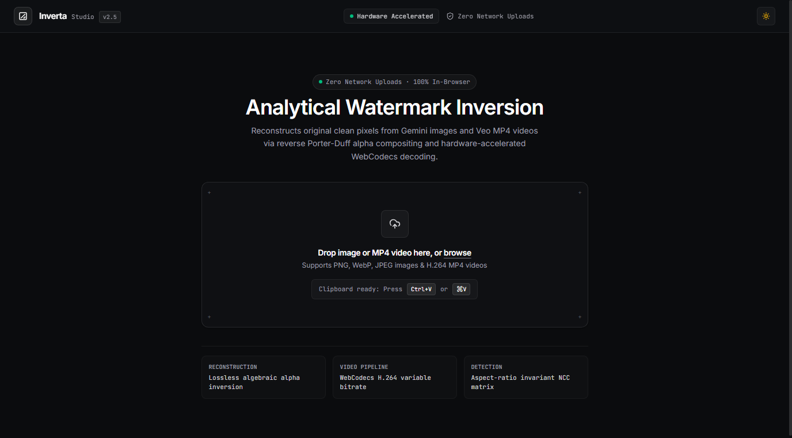

<div align="center">

# Inverta Studio

### Precision Analytical AI Watermark Inversion for Gemini Images & Veo MP4 Videos

**100% Client-Side · Zero Server Uploads · Hardware-Accelerated WebCodecs**

<br />

<a href="https://talha-quraishi.github.io/inverta-studio/">
  
</a>

<br /><br />

[](https://talha-quraishi.github.io/inverta-studio/)
[](https://github.com/Talha-Quraishi/inverta-studio/stargazers)
[](https://github.com/Talha-Quraishi/inverta-studio/network/members)
[](https://opensource.org/licenses/MIT)
[](#privacy--zero-uploads)
[](#video-pipeline)
[](#studio-ui)

<br />

<a href="https://talha-quraishi.github.io/inverta-studio/">
  
</a>

</div>

---

## ⚡ Try It in 3 Seconds (Zero Install)

You don't need to clone, install Python, or configure CUDA to use Inverta Studio:

1. **Open the Live App**: **[https://talha-quraishi.github.io/inverta-studio/](https://talha-quraishi.github.io/inverta-studio/)**
2. **Drop or Paste Media**: Drag & drop any image or MP4 video, or simply press **`Ctrl + V`** (**`⌘ + V`**) to paste from clipboard.
3. **Compare & Export**: Inspect with the real-time split/swipe comparison slider and 2.2× corner loupe, then click **Export Cleaned Video (MP4)** or **Save Image (PNG)**.

> [!IMPORTANT]
> **100% In-Browser Privacy**: Your videos and photos never leave your device. All demuxing, decoding, mathematical inversion, and re-encoding runs locally in browser RAM using the native WebCodecs API and Canvas 2D. Files over 1 GiB are rejected to keep in-memory processing fast and stable.

---

## 🔬 Why Mathematical Inversion?

Most watermark removal tools use generative AI inpainting (e.g., LaMa, Stable Diffusion) or blur brushes. These methods guess, hallucinate, and smear pixels, destroying fine textures, intricate jewelry, skin pores, and sharp text.

**Inverta Studio** takes a strictly mathematical approach: Google applies its watermarks as a linear translucent alpha blend. By isolating the exact calibrated alpha masks, Inverta Studio solves the blending formula in reverse, **recovering the original clean pixels losslessly without hallucination**:

| Feature | **Inverta Studio** | AI Diffusion / Inpainting (LaMa / SD) | Online Cloud Removers |
| :--- | :---: | :---: | :---: |
| **Inversion Method** | **Exact Mathematical Inversion** | Generative hallucination / smearing | Blurry content-aware fill |
| **Pixel Preservation** | **100% Lossless Original Pixels** | Destructive; guesses textures | Lossy recompression artifacts |
| **Privacy & Security** | **100% In-Browser RAM (Zero Uploads)** | Local GPU or remote server | Uploads private media to cloud |
| **Video Processing** | **WebCodecs H.264 (Frame-by-Frame)** | Temporal jitter / frame drift | Heavy server wait times / paywalls |
| **Cost & Credits** | **100% Free & Open Source (MIT)** | Requires high-end GPU hardware | Paid subscriptions / per-minute fees |
| **Setup Time** | **Instant (Zero Install)** | Complex Python, PyTorch & CUDA | Account registration required |

---

## 🎯 Supported Models & Formats

Inverta Studio includes calibrated alpha templates for all current and historical Google AI generation models:

| Generation Model | Watermark Type | Supported Media | Default Position |
| :--- | :--- | :--- | :--- |
| **Google Imagen 3 & Imagen 2** (Gemini Web, Gemini Advanced, Vertex AI) | **Gemini Sparkle** (96px / 48px) | PNG, WebP, JPEG, BMP | Bottom-Right (Canonical 64px / 32px) |
| **Google Veo & Veo 2** (VideoFX, YouTube Shorts AI, AI Studio) | **2026 Sparkle** (96px / 48px) | MP4 (H.264 / AAC) | Bottom-Right (Resolution-scaled) |
| **Google Bard / Early Gemini** (Early 2024 Models) | **Classic Dual-Star** (84px) | PNG, JPEG, MP4 | Bottom-Right (84px Paired Star) |
| **High-Contrast Overlays** | **White Sparkle** (96px / 48px) | Images & Videos | Quadrant-adaptive |

---

## ✨ Key Features

- **Generative Images & Veo MP4 Videos**: Full support for still images (PNG, WebP, JPEG, BMP) and high-bitrate MP4 video files generated by Google Gemini, Imagen, Veo, Flow, and AI Studio.
- **Aspect-Ratio Invariant Detection**: Automatically detects watermarks across 16:9 widescreen, 9:16 portrait/vertical videos (TikTok, YouTube Shorts, Reels), 1:1 square, and arbitrary custom aspect ratios.
- **Anti-Drift Canonical Margin Bias**: Prevents false detections on glowing background elements (such as candles, flames, or circular ornaments) by locking onto Google's canonical margin coordinates.
- **Hardware-Accelerated Video Pipeline**: MP4Box.js demuxer paired with the native WebCodecs API (`VideoDecoder` / `VideoEncoder`) for fast frame-by-frame processing.
- **Studio-Grade UI**:
  - **Light & Dark Mode**: Handcrafted studio palettes with instant toggle and persistence.
  - **Buttery-Smooth Viewport**: 60–120fps comparison slider synchronized via `requestAnimationFrame` with zero cursor lag.
  - **2.2× Corner Loupe**: Precision magnification focused directly on the watermark quadrant with 1:1 zoom inspection.
  - **Synchronized Video Player**: Interactive Swipe slider, Side-by-Side split view, 24fps frame-by-frame stepper, and precision timecode scrubber.
  - **Pro Keyboard Ergonomics**: Spacebar to play/pause, left/right arrows for frame stepping and slider nudging, `Z` for corner loupe, `F` to fit view, and `1-4` for viewport modes.

---

## 📐 Mathematical Foundation

Google applies its visual watermarks using standard Porter-Duff source-over alpha blending:

$$\text{Watermarked Pixel} = (1 - \alpha \cdot q) \cdot \text{Original Pixel} + (\alpha \cdot q) \cdot 255$$

Inverta Studio solves this equation algebraically channel-by-channel:

$$\text{Original Pixel} = \frac{\text{Watermarked Pixel} - \alpha \cdot q \cdot 255}{1 - \alpha \cdot q}$$

Where:
- $\alpha \in [0, 1]$ is the calibrated alpha mask transparency value for the pixel.
- $q$ is the gain drift compensation factor addressing lossy video/image compression artifacts.
- $255$ represents the pure white watermark luminance.

For saturated core pixels where $\alpha \ge 0.98$ (where original pixel luminance is completely eclipsed by the watermark), an 8-neighbor harmonic Laplace diffusion fill smoothly propagates edge frequencies into the center, eliminating residual halos.

---

## ❓ Frequently Asked Questions (FAQ)

<details>
<summary><b>Does Inverta Studio upload my photos or videos anywhere?</b></summary>
<br>
<b>No, absolutely not.</b> Everything runs 100% locally in your browser's WebAssembly and JavaScript environment. Your media never leaves your device and is never transmitted over any network. You can even disconnect your internet after loading the page and the tool will continue working.
</details>

<details>
<summary><b>Why is mathematical inversion better than AI inpainting tools?</b></summary>
<br>
AI inpainting brushes (like LaMa or Photoshop Generative Fill) completely delete the pixels under the watermark and ask an AI to guess what was behind it. This creates smudged textures, distorted faces, and blurry details. 

Because Google's watermark is translucent, the original pixel information is still present underneath. Inverta Studio uses the exact inverse blending equation to subtract the white overlay and mathematically restore your original clean pixels with zero quality degradation.
</details>

<details>
<summary><b>Does this remove SynthID?</b></summary>
<br>
<b>No.</b> SynthID is an imperceptible digital watermark embedded into the latent/frequency domain of generated images and audio. Inverta Studio exclusively inverts the visible 4-pointed graphic overlay so your media is aesthetically clean, leaving underlying cryptographic provenance intact.
</details>

---

## 🛠️ Local Development

If you wish to run or modify Inverta Studio locally:

### Prerequisites
- Node.js 20.19+ or 22.12+ (required by Vite 8)
- npm or pnpm
- A modern Chromium-based browser (Chrome, Edge, Brave, Opera) with WebCodecs support.

### Setup

```bash
# Clone the repository
git clone https://github.com/Talha-Quraishi/inverta-studio.git
cd inverta-studio

# Install dependencies
npm install

# Start local development server
npm run dev
```

Open your browser at `http://localhost:5173`.

### Production Build & Test

```bash
# Run automated test suite
npm test

# Build production bundle
npm run build
```

Production artifacts are compiled into the `dist/` directory. Pushes to `main` are automatically tested and published to GitHub Pages by `.github/workflows/deploy.yml`.

---

## 🏛️ Architecture

```
inverta-studio/
├── public/
│   ├── masks/                 # Calibrated alpha mask templates (48px and 96px)
│   ├── robots.txt             # Search engine crawl directives
│   ├── sitemap.xml            # Search engine indexing sitemap
│   └── og-preview.png         # Social share preview image (1200x630)
├── src/
│   ├── components/
│   │   ├── Header.tsx         # Brand identity, telemetry badges, and GitHub Star CTA
│   │   ├── DropZone.tsx       # Drag & drop, browse, and clipboard paste (Ctrl+V / ⌘V)
│   │   ├── ComparisonSlider.tsx # 60-120fps RAF slider, 2.2x loupe, pan/zoom
│   │   ├── VideoPlayerComparison.tsx # WebCodecs playback, split/swipe view, frame stepper
│   │   ├── ControlsPanel.tsx  # Diagnostics HUD, template selector, nudge micro-stepper
│   │   └── BatchQueue.tsx     # Asset filmstrip and bulk export
│   ├── engine/
│   │   ├── watermarkEngine.ts # Analytical alpha inversion & multi-template NCC search
│   │   ├── videoEngine.ts     # MP4Box demuxer + WebCodecs VideoDecoder/VideoEncoder
│   │   ├── nccMatcher.ts      # Fast normalized cross-correlation algorithm
│   │   ├── alphaMasks.ts      # Scaled mask cache & bilinear resampling
│   │   └── diffusionFill.ts   # Harmonic Laplace diffusion core inpainting
│   ├── utils/
│   │   └── assetUrl.ts        # Environment-aware asset path resolver for subpaths
│   ├── App.tsx                # Studio layout, theme provider, and zero-hang pipeline
│   └── index.css              # Tailwind CSS v4 design tokens and studio typography
└── dist/                      # Production build output
```

---

## ⭐ Support the Project

If Inverta Studio saved you time or helped you restore your images and videos, please consider giving it a **Star**! ⭐ It helps more creators and developers discover the tool.

[](https://star-history.com/#Talha-Quraishi/inverta-studio&Date)

---

## 🤝 Community & Contributing

- **Found a bug?** Open an [Issue](https://github.com/Talha-Quraishi/inverta-studio/issues).
- **Want to add a template?** Pull requests are welcome!
- **Feedback & Suggestions?** Start a discussion or submit a PR.

---

## 📄 License

This project is licensed under the [MIT License](LICENSE).
